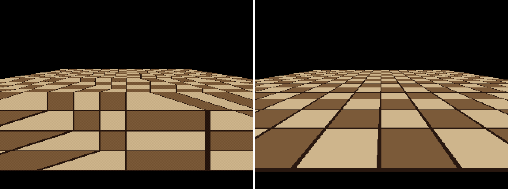
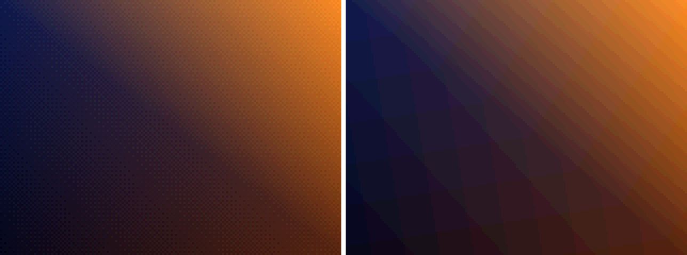
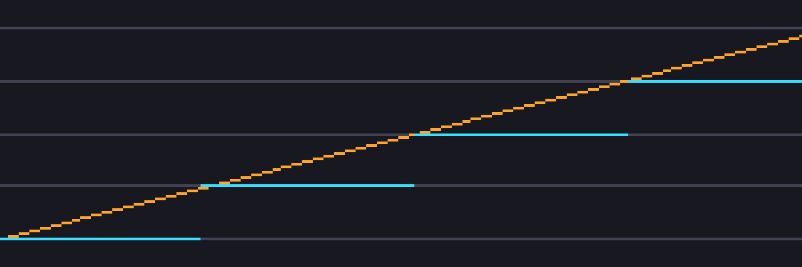
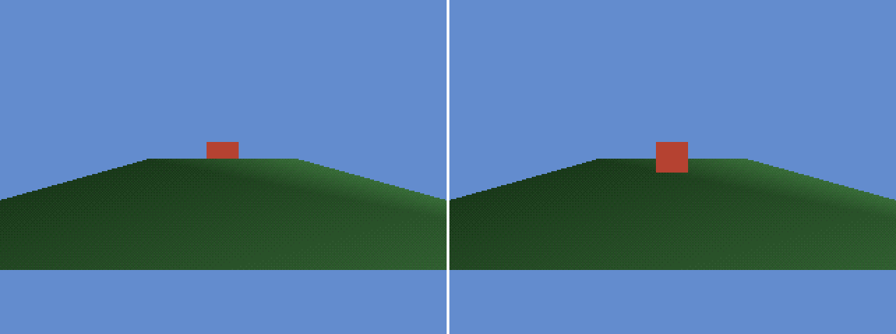
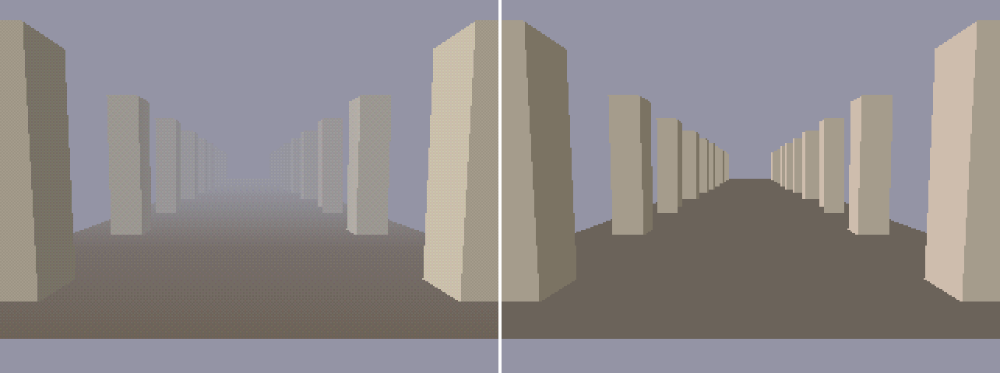
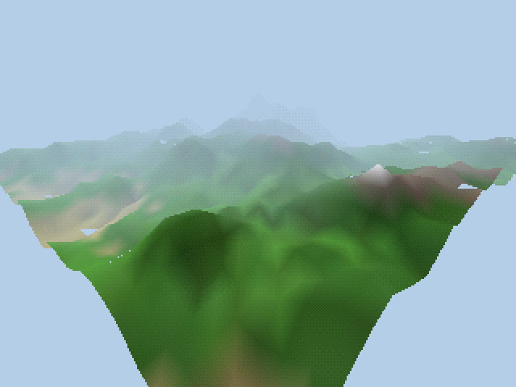
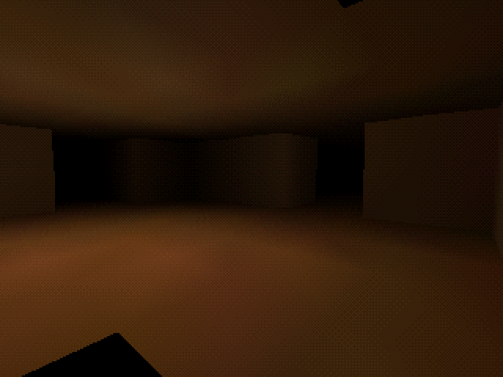

# Reference images

> **TL;DR**: These images are generated by this repository's Python tools
> ([SIM]), so they show each PS1 artifact in isolation next to a "modern"
> rendering of the same scene. They contain no game assets. To regenerate them:
> `python -m ref.tools.demo --out ref/look/images`, plus the two `worldgen`
> commands below.

| Image | Left / top = PS1 rules | Right / bottom = modern | Teaches |
|-------|------------------------|-------------------------|---------|
|  `affine_vs_perspective.png` | Affine UVs, integer vertices, dither | Perspective-correct, float vertices | [Affine warping](../visual-signature.md#1-affine-texture-warping-hw): the checker lines bend, and kink along each quad's diagonal |
|  `dither_vs_none.png` | 15-bit + PS1 4×4 dither | 15-bit, no dither | [Banding vs grain](../visual-signature.md#6-15-bit-colour-banding-and-dither-hw) |
|  `jitter_chart.png` | Cyan: GTE integer screen X of a vertex sliding 30 units at depth 2000 | Orange: float projection | [Vertex snapping](../visual-signature.md#2-vertex-snapping--jitter-hw): the screen position moves in whole-pixel jumps. Grey lines are pixel boundaries. |
|  `sorting_ot_vs_zbuffer.png` | Ordering table (one average depth per polygon) | Z-buffer | [Sorting errors](../visual-signature.md#4-sorting-errors-no-z-buffer-hw): the large floor quad's average depth is nearer than the cube's, so the floor is drawn over the cube |
|  `fog_depthcue.png` | GTE-style per-vertex depth cue toward the fog colour | No fog | [Fog and draw distance](../visual-signature.md#10-fog-and-draw-distance-hw-typ). Note the uneven fog on large polygons. |
|  `worldgen_terrain.png` | `worldgen terrain`, baked vertex colour + depth cue + dither | n/a | [Procedural recipes § A](../../world/procedural-recipes.md#a-tile-terrain-with-baked-vertex-colour) |
|  `worldgen_dungeon.png` | `worldgen dungeon`, baked torch light into black fog | n/a | [Procedural recipes § B](../../world/procedural-recipes.md#b-sector-grid-dungeon). The black wedge at the lower left is authentic near-plane dropout. |

```bash
python -m ref.tools.worldgen terrain --out terrain.obj --png ref/look/images/worldgen_terrain.png
python -m ref.tools.worldgen dungeon --out dungeon.obj --png ref/look/images/worldgen_dungeon.png
```

All images are 320×240 (or smaller) internal renders, upscaled with integer
nearest-neighbour filtering.
