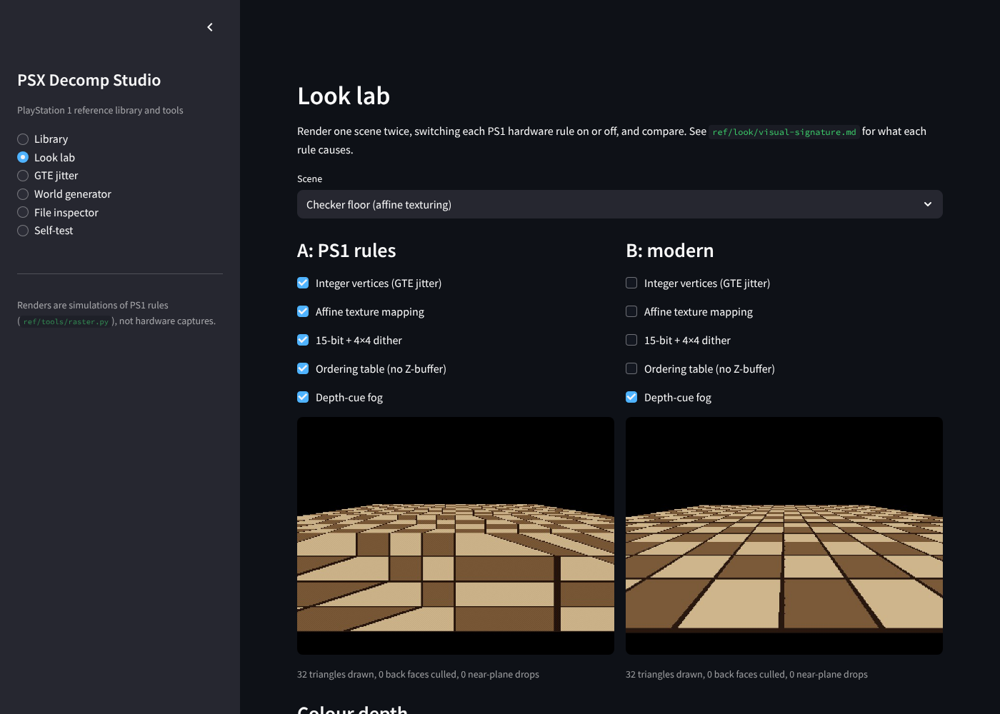
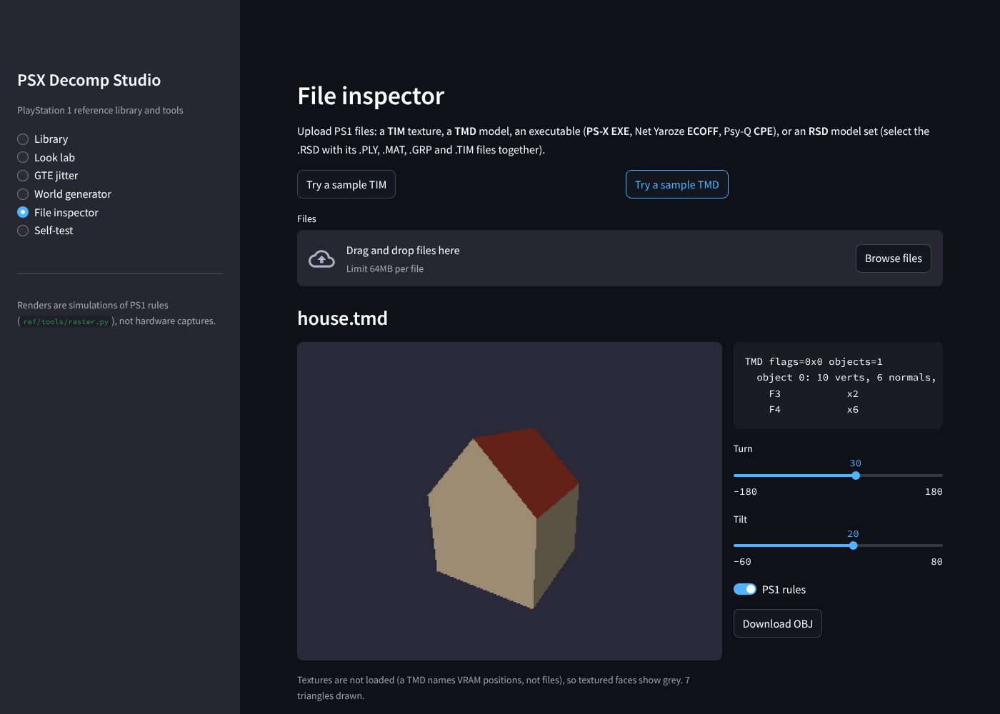

# PSX Decomp Studio: web UI

A browser front end for the `ref/` library and tools, in the style of
[opencanary-ui](https://github.com/chrisjbawden/opencanary-ui): a Streamlit
app with a sidebar of pages, shipped as a Docker image whose port is set by an
environment variable.



## Pages

| Page | What it does | Tools behind it |
|------|--------------|-----------------|
| **Library** | Search and read every reference document (by title, tag or summary), with its images | `ref/index.json`, `ref/**/*.md` |
| **Look lab** | Render a scene twice and switch each PS1 rule on or off: integer vertices, affine texturing, dither, ordering table, fog | `ref/tools/raster.py`, `ref/tools/demo.py` scene specs |
| **GTE jitter** | Chart a vertex's float and GTE-integer screen position as it moves | `ref/tools/fixedpoint.py` |
| **World generator** | Generate terrain or a dungeon from a seed, preview it PS1-style, download the OBJ | `ref/tools/worldgen.py` |
| **File inspector** | Upload a TIM (view it, switch palettes), a TMD (spin a PS1-style preview, export OBJ), an RSD set (link it to TMD like RSDLINK), or an executable (PS-X EXE / ECOFF / CPE header). Built-in samples included. | `tim.py`, `tmd.py`, `rsd.py`, `exe.py` |
| **Self-test** | Run the `ref/` test suite in the browser | `ref/tests/` |



## Run it

**Docker** (from the repository root):

```bash
docker compose up ui                          # http://localhost:8501
UI_PORT=9000 docker compose up ui             # another port
PSX_UI_PASSWORD=secret docker compose up ui   # require a password
```

or without compose:

```bash
docker build -f ui/Dockerfile -t psx-ui .
docker run --rm -p 127.0.0.1:8501:8501 psx-ui
```

**Locally** (Python 3.9+):

```bash
pip install -r ui/requirements.txt
cd ui && streamlit run app.py
```

## Settings

| Variable | Default | Meaning |
|----------|---------|---------|
| `UI_PORT` | `8501` | Port the app listens on (and, with compose, the host port) |
| `UI_BIND` | `0.0.0.0` | Address inside the container. It must stay `0.0.0.0` to be reachable through Docker's port mapping. |
| `UI_HOST` | `127.0.0.1` | (compose) Host address to publish on. Set `0.0.0.0` to reach it from other machines. |
| `PSX_UI_PASSWORD` | empty | If set, the app asks for this password before showing anything |

## Security notes

* There is **no default login**. opencanary-ui ships `admin`/`admin`, but
  this app shows no pages until you set your own password, and only if you
  set one.
* Compose publishes on `127.0.0.1` by default, so the app is not reachable
  from your network until you choose to expose it.
* Uploaded files are parsed in memory by the `ref/` parsers, which reject
  malformed data with an error rather than guessing. An RSD set is written to
  a temporary folder that is deleted straight away. Uploads are capped at
  64 MB (`ui/.streamlit/config.toml`).
* The container runs as an unprivileged user, needs no extra capabilities, and
  has a health check on Streamlit's `/_stcore/health`.

## How it is built

* `ui/logic.py` holds every action as plain Python, with no Streamlit import,
  so it can be tested and scripted. `ui/app.py` only lays out widgets.
* `ref/` stays standard-library only. Streamlit is the UI's only dependency
  (`ui/requirements.txt`).
* Tests: `python -m unittest discover -s ui/tests -t .`. The logic tests need
  only Python. The app tests drive the real Streamlit app headlessly (all
  pages, the sample inspector, the password gate) when Streamlit is installed.
* Links inside rendered documents point to repository paths. Use the document
  picker to move between documents.
